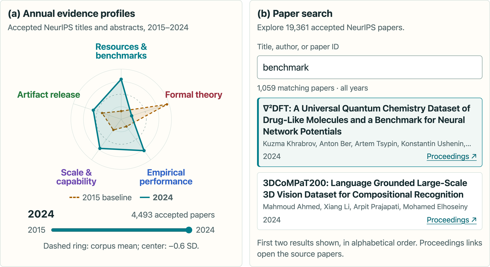

**Short answer:** Accepted NeurIPS titles and abstracts increasingly foreground benchmarks and resources, empirical performance, and scale, while formal-theory framing declines. The changing mix of research topics explains much of the shift, but topic-adjusted estimates retain those four directions. The Evidence Norms Atlas makes these patterns inspectable across **19,361 accepted papers from 2015–2024**.

**[Explore the Evidence Norms Atlas →](https://jasongodfrey.com/atlas)**

## Explore the evidence

Compare annual evidence profiles, search for individual papers, and follow their links to the official proceedings. The Atlas connects aggregate patterns to concrete examples so readers can inspect the measurement and question its interpretation.

The accompanying study scores each title and abstract against frozen, researcher-specified descriptions of contrasting evidence forms. Five axes support the main analysis; two additional axes describe stance. The raw fitted decade trends, measured in corpus standard deviations, are:

| Evidence framing | Raw fitted decade trend |
| --- | ---: |
| Benchmark / resource | +0.842 |
| Empirical performance | +0.750 |
| Scale / capability | +0.606 |
| Formal theory | −0.872 |

These estimates describe changes in standardized framing scores. They are distinct from the annual mean profiles shown in the Atlas. Embedding-cluster and independent lexical-topic controls reduce the four trends without reversing their directions. Artifact-release framing is the exception: its modest raw increase approaches zero or becomes negative after topic adjustment.

## Why this resource matters

The release gives researchers a common corpus, documented measurement choices, derived features, validation outputs, and reproduction code. It supports reproducing the reported patterns, comparing alternative measurement instruments, and extending the baseline to later years. New axes need fresh construct validation, and new years need a comparable reference scale. Transfer to other venues remains untested.

The scope is evidence framing in accepted titles and abstracts. The scores do not assess research quality, establish reviewers' preferences, or describe rejected submissions. Blinded LLM ratings test construct recognizability; there is no human annotation gold standard. Topic adjustment is descriptive and does not establish a causal separation of topic and rhetoric.

## Paper and release

Jason Godfrey. **Auditing Evidence Framing at NeurIPS: A Decade-Scale Study of Accepted Papers.** Accepted at **NeurIPS 2026, Evaluations & Datasets**.

- [Paper on OpenReview](https://openreview.net/forum?id=d3J7bxCLHH)
- [Interactive Evidence Norms Atlas](https://jasongodfrey.com/atlas)
- [Data, validation outputs and reproduction code — Kaggle version 4](https://www.kaggle.com/datasets/jasongodfrey/neurips-evidence-framing-audit/versions/4)
- [Atlas source on GitHub](https://github.com/ja-godfrey/evidence-norms-atlas)
